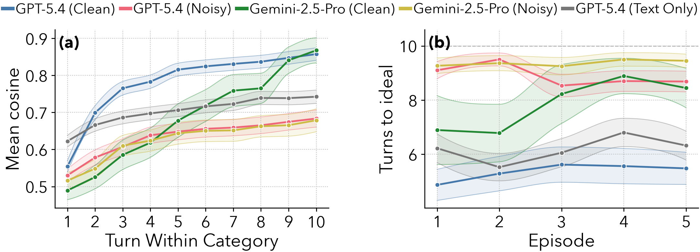

# Expanded-scale learning curves

**(a)** Mean sidebar cosine to the hidden target by turn within a category. **(b)** Turns to ideal by episode with SE. All arms use the expanded runs (15 personas repeated 3 times). All runs follow similar trajectories as the main paper runs. 
