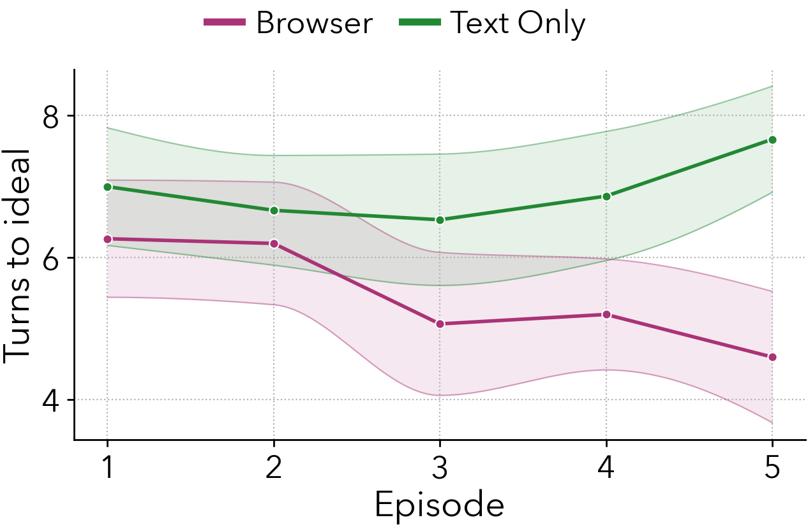

# Specialized harness: with logs vs text only

Turns to ideal across episodes for the specialized harness (GPT-5.4) compared to a text-only specialized harness (GPT-5.4). Results show that across episodic learning is only present in the full browser version. 

